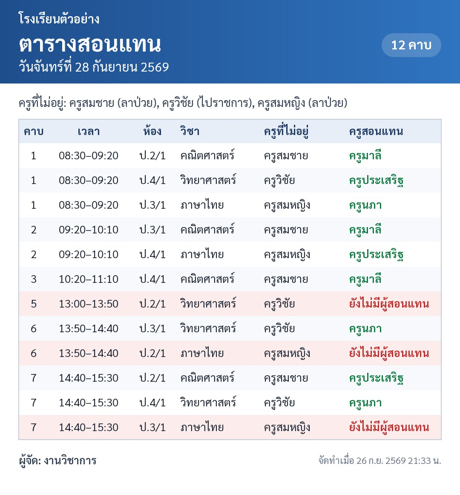

# 📋 ระบบจัดสอนแทน

ระบบจัดครูสอนแทนสำหรับโรงเรียน ใช้งานบนมือถือ เก็บข้อมูลใน Google Sheets (ฟรี) สร้างภาพตารางสอนแทน และส่งเข้ากลุ่มไลน์พร้อม **@แท็กชื่อ** ครูผู้สอนแทน

**หน้าเว็บ:** https://pdrweb-system.github.io/teachtimetables/



## ความสามารถ

- เลือกครูที่ไม่อยู่ → ระบบดึงคาบสอนของวันนั้นจากตารางสอนมาให้เอง
- เลือกครูสอนแทนจากรายชื่อ **เฉพาะครูที่ว่างในคาบนั้น** พร้อมแสดงภาระ (แทนวันนี้ / เดือนนี้ / สอนเอง)
- ปุ่ม **⚡ จัดอัตโนมัติ** — เลือกครูว่างที่มีภาระน้อยที่สุดให้ (เฉลี่ยงานทั้งเดือน, ภาระเท่ากันให้กลุ่มสาระเดียวกันก่อน)
- ตรวจจับการชน: ครูที่ลาอยู่, ครูมีคาบของตัวเอง, ครูถูกจัดซ้ำคาบเดียวกัน
- เพิ่มคาบ/ภาระงานนอกตาราง เช่น เวรประตู กิจกรรม
- **บันทึก + สร้างภาพ** ตารางสอนแทน → กดค้างเพื่อบันทึกรูป / แชร์ / เปิดใน Google Drive
- **ส่งเข้ากลุ่มไลน์** ภาพ + ข้อความ พร้อม @แท็กชื่อครูผู้สอนแทน
- คำสั่ง `สอนแทน` ในกลุ่มไลน์ — บอทตอบภาพ + แท็กชื่อ **ไม่เสียโควตา**
- หน้าสถิติรายเดือน: ใครสอนแทนกี่คาบ ใครลากี่วัน

## ภาพรวมระบบ

```
มือถือครู ──► หน้าเว็บบน GitHub Pages (index.html)
                 │  เรียกข้อมูลผ่าน URL /exec
                 ▼
            Google Apps Script (apps-script/Code.gs) ──► Google Sheets (ฐานข้อมูล)
                 ▲                                   ├─► Google Drive (เก็บภาพ)
LINE ── webhook ─┘                                   └─► LINE Messaging API
```

หน้าเว็บอยู่บน GitHub Pages จึง **ไม่มีแถบเตือน "แอปพลิเคชันนี้สร้างโดยผู้ใช้ Google Apps Script"** ส่วนข้อมูลทั้งหมดอยู่ใน Google Sheet ของโรงเรียนเอง

---

## ติดตั้ง

> เคยติดตั้งเวอร์ชันแรก (เปิดใช้ผ่านลิงก์ script.google.com โดยตรง) อยู่แล้ว → ข้ามไปที่ [อัปเดตจากเวอร์ชันเดิม](#อัปเดตจากเวอร์ชันเดิม)

### ขั้นที่ 1 — สร้างฐานข้อมูลใน Google Sheet

1. สร้าง Google Sheet ใหม่ (แนะนำใช้ **บัญชี Gmail ส่วนตัว** ของผู้ดูแล — บัญชีโรงเรียนบางแห่งห้ามแชร์ไฟล์แบบสาธารณะ ทำให้ส่งภาพเข้าไลน์ไม่ได้)
2. เมนู **ส่วนขยาย → Apps Script**
3. ลบโค้ดเดิมในไฟล์ `Code.gs` แล้ววางโค้ดทั้งหมดจากไฟล์ [`apps-script/Code.gs`](apps-script/Code.gs) (เปิดไฟล์ใน GitHub แล้วกดปุ่ม **Copy raw file** มุมขวาบน)
4. กดบันทึก 💾 เลือกฟังก์ชัน `setup` แล้วกด **เรียกใช้ (Run)** → อนุญาตสิทธิ์ (ถ้าขึ้น "Google hasn't verified this app" ให้กด Advanced → Go to …)
5. กลับไปที่ Sheet จะมีชีตใหม่ 7 ชีตพร้อมข้อมูลตัวอย่าง

> ไม่ต้องสร้างไฟล์ HTML ใน Apps Script — หน้าเว็บอยู่บน GitHub Pages แล้ว

### ขั้นที่ 2 — กรอกข้อมูลโรงเรียน

| ชีต | กรอกอะไร |
|---|---|
| **ตั้งค่า** | ชื่อโรงเรียน, **รหัส PIN (เปลี่ยนจาก 1234 ทันที — แนะนำ 6 หลักขึ้นไป)**, ชื่อผู้จัด, ข้อความท้ายประกาศ |
| **ครู** | ชื่อครู (ใช้เป็นรหัส ห้ามซ้ำ), ชื่อที่แสดง (สั้น ๆ เช่น ครูสมชาย), กลุ่มสาระ, ใช้งาน = TRUE/FALSE — คอลัมน์ LINE userId ระบบกรอกเอง |
| **คาบเรียน** | เลขคาบ, เวลาเริ่ม, เวลาสิ้นสุด (พิมพ์แบบ 08:30) |
| **ตารางสอน** | 1 แถว = 1 คาบ: ชื่อครู, วัน (จันทร์…ศุกร์ หรือ จ/อ/พ/พฤ/ศ), คาบ, วิชา, ห้อง |

> ลบข้อมูลตัวอย่างในชีต **ครู** และ **ตารางสอน** ก่อนใส่ของจริง
> ชื่อครูในชีตตารางสอนต้องตรงกับชีตครูทุกตัวอักษร (มี dropdown ให้เลือก)

### ขั้นที่ 3 — Deploy เป็น Web app

1. ใน Apps Script กด **การทำให้ใช้งานได้ (Deploy) → การทำให้ใช้งานได้รายการใหม่**
2. ประเภท: **เว็บแอป** · ดำเนินการในฐานะ: **ฉัน** · ผู้มีสิทธิ์เข้าถึง: **ทุกคน**
3. คัดลอก URL ที่ลงท้ายด้วย **`/exec`** (ไม่ใช่ `/dev`)
4. ลองเปิด URL นั้นในเบราว์เซอร์ ต้องเห็นข้อความประมาณ `{"ok":true,"result":{"service":"ระบบจัดสอนแทน API",…}}`

> **แก้ Code.gs ภายหลัง:** Deploy → จัดการการทำให้ใช้งานได้ → ✏️ แก้ไข → เวอร์ชัน: **เวอร์ชันใหม่** → ทำให้ใช้งานได้
> (URL เดิมไม่เปลี่ยน ไม่ต้องตั้งค่าในหน้าเว็บหรือ Webhook ใหม่ — แต่ถ้ากดบันทึกอย่างเดียว URL `/exec` จะยังใช้โค้ดเก่า)

### ขั้นที่ 4 — เปิดหน้าเว็บและเชื่อมกับ Apps Script

1. (ทำครั้งเดียว โดยผู้ดูแล repo) GitHub → **Settings → Pages** → Source: **Deploy from a branch** → Branch: `main` / `(root)` → Save แล้วรอ 1–2 นาที
2. เปิด https://pdrweb-system.github.io/teachtimetables/ ในมือถือ
3. แท็บ **⚙️ ตั้งค่า → การเชื่อมต่อ API** → วาง URL `/exec` จากขั้นที่ 3 → **บันทึก** → ต้องขึ้น "เชื่อมต่อสำเร็จ ✓ ชื่อโรงเรียน"
4. เมนูเบราว์เซอร์ → **เพิ่มไปยังหน้าจอหลัก** จะได้ไอคอนเหมือนแอป

URL จะถูกจำไว้ในเครื่องนั้น เครื่องอื่นต้องกรอกครั้งแรกครั้งเดียว
(ฝัง URL ไว้ในโค้ดก็ได้ที่ `var APPS_SCRIPT_URL = ''` ใน `index.html` แต่ไฟล์บน GitHub Pages ใครก็เปิดดูได้ — คนนอกจะรู้ URL และอ่านตารางสอน/รายการลาได้ จึงแนะนำให้กรอกในแต่ละเครื่องแทน)

### ขั้นที่ 5 — เชื่อม LINE (ส่งเข้ากลุ่ม + แท็กชื่อ)

**5.1 สร้างบอท (ฟรี)**
1. ไปที่ https://manager.line.biz สร้าง **LINE Official Account** (แผนฟรี)
2. ในหน้า OA Manager → **ตั้งค่า → Messaging API → เปิดใช้งาน** (สร้าง Provider ชื่ออะไรก็ได้)
3. **ตั้งค่า → การตอบกลับ**: ปิด "ข้อความตอบกลับอัตโนมัติ" และ "ข้อความทักทาย", เปิด **Webhook**
4. ไปที่ https://developers.line.biz/console → เลือก Channel ของบอท → แท็บ **Messaging API**
   - **Webhook URL** = URL `/exec` เดียวกับขั้นที่ 3 (ดูได้ในหน้าเว็บ แท็บตั้งค่า → เชื่อมต่อ LINE) → เปิด **Use webhook**
   - **Allow bot to join group chats** = เปิด
   - เลื่อนลงล่าง **Channel access token (long-lived)** → กด Issue → คัดลอก

> ถ้ากด **Verify** แล้วขึ้น error 302 ไม่ต้องกังวล — เป็นลักษณะปกติของ Apps Script ระบบยังรับข้อความได้ ให้ทดสอบด้วยการพิมพ์ `คำสั่ง` ในกลุ่มแทน

**5.2 ใส่ Token ในระบบ** — หน้าเว็บ แท็บ **ตั้งค่า → แสดงการตั้งค่า LINE** → ใส่ PIN → วาง Token → **บันทึก** (ระบบจะแสดงชื่อบอทถ้าถูกต้อง)

**5.3 เชิญบอทเข้ากลุ่มครู**
- เชิญบอทเข้ากลุ่มไลน์ครู → บอททักทายและ **ตั้งกลุ่มนั้นเป็นกลุ่มรับประกาศอัตโนมัติ**
- ถ้าบอทอยู่หลายกลุ่ม พิมพ์ `ตั้งกลุ่มนี้` ในกลุ่มที่ต้องการ
- กด **ส่งข้อความทดสอบเข้ากลุ่ม** ในหน้าตั้งค่าเพื่อตรวจสอบ

**5.4 ให้ครูผูกชื่อ (เพื่อให้แท็กได้)** — การแท็กต้องรู้ LINE userId ของครูแต่ละคน ซึ่ง LINE ให้มาเมื่อครูพิมพ์ในกลุ่มเท่านั้น
- **วิธีแนะนำ:** ให้ครูแต่ละคนพิมพ์ในกลุ่ม `ลงทะเบียน สมชาย` (ชื่อจริงหรือบางส่วนของชื่อ) → บอทตอบ @แท็กยืนยัน
- **วิธีที่ 2:** ให้ครูพิมพ์อะไรก็ได้ในกลุ่ม 1 ครั้ง แล้วแอดมินไปที่ **ตั้งค่า → ผูกชื่อครูกับไลน์** เลือกชื่อไลน์ให้ตรงกับครู

ครูที่ยังไม่ผูก จะแสดงเป็นชื่อธรรมดา (ไม่แท็ก) และระบบจะแจ้งรายชื่อหลังส่ง

### อัปเดตจากเวอร์ชันเดิม

ถ้าเคยติดตั้งเวอร์ชันแรก (หน้าเว็บอยู่ใน Apps Script, เปิดผ่านลิงก์ `script.google.com/…/exec`):

1. วางโค้ดจาก [`apps-script/Code.gs`](apps-script/Code.gs) ทับ `Code.gs` เดิม (ถ้าเคยแก้โค้ดเองไว้ ให้เทียบก่อนทับ) — ข้อมูลในชีตใช้ต่อได้เลย ไม่ต้องรัน `setup` ใหม่
2. ลบไฟล์ `Index` (HTML) ใน Apps Script ทิ้ง
3. Deploy → จัดการการทำให้ใช้งานได้ → ✏️ แก้ไข → **เวอร์ชันใหม่** → ทำให้ใช้งานได้ (URL `/exec` เดิม จึงไม่ต้องเปลี่ยน Webhook ของ LINE)
4. ทำ[ขั้นที่ 4](#ขั้นที่-4--เปิดหน้าเว็บและเชื่อมกับ-apps-script) โดยใช้ URL `/exec` เดิม
5. ลิงก์/ไอคอนเดิมที่ชี้ไป `script.google.com` จะกลายเป็นหน้าข้อความ JSON — ให้ครูเปลี่ยนไปใช้ลิงก์ GitHub Pages แทน

---

## วิธีใช้ประจำวัน (บนมือถือ)

1. เลือกวันที่ (ปุ่ม ‹ › เลื่อนวัน)
2. **+ เพิ่มครู** → แตะชื่อครูที่ไม่อยู่ → เลือกเหตุผล (ลาป่วย/ลากิจ/ไปราชการ…)
3. กด **⚡ จัดอัตโนมัติ** หรือเลือกครูสอนแทนเองทีละคาบ (แถบสี: 🟧 ยังไม่จัด · 🟩 จัดแล้ว · 🟥 ชน)
4. **💾 บันทึก + สร้างภาพ** → ใส่ PIN (ครั้งแรกครั้งเดียว)
5. ในหน้าภาพ: **📤 ส่งเข้ากลุ่มไลน์ + แท็กชื่อ** / 📥 บันทึกภาพ / ☁️ เปิดใน Drive

แก้ไขวันเดิมภายหลังได้ — เปิดวันนั้น แก้ แล้วบันทึกใหม่ (ข้อมูลเดิมของวันนั้นจะถูกแทนที่)

## คำสั่งในกลุ่มไลน์

| พิมพ์ | ผลลัพธ์ |
|---|---|
| `สอนแทน` | ตารางสอนแทนวันนี้ (ภาพ + แท็กชื่อ) |
| `สอนแทนพรุ่งนี้` / `สอนแทนมะรืน` | ของวันพรุ่งนี้ / มะรืนนี้ |
| `ลงทะเบียน ชื่อ` | ผูกไลน์กับชื่อครู |
| `ตั้งกลุ่มนี้` | ใช้กลุ่มนี้รับประกาศ |
| `คำสั่ง` | แสดงรายการคำสั่ง |

## ค่าใช้จ่าย (ฟรีทั้งหมด)

| ส่วน | ค่าใช้จ่าย |
|---|---|
| GitHub Pages / Google Sheets / Apps Script / Drive | ฟรี |
| คำสั่ง `สอนแทน` ในกลุ่ม (บอทตอบกลับ = reply) | **ฟรี ไม่จำกัด** |
| ปุ่ม "ส่งเข้ากลุ่มไลน์" ในหน้าเว็บ (push) | ใช้โควตาแผนฟรีของ LINE OA |

**สำคัญ:** การ push เข้ากลุ่มนับโควตาตาม **จำนวนสมาชิกในกลุ่ม** (กลุ่มครู 40 คน = ส่ง 1 ครั้งใช้ ~40 ข้อความ) โควตาแผนฟรีจำกัดต่อเดือน ดูยอดที่ใช้ได้ในหน้า **ตั้งค่า → เชื่อมต่อ LINE**

แนวทางประหยัด: กดบันทึกในหน้าเว็บ (ภาพจะถูกเก็บลง Drive อัตโนมัติ) แล้วให้ผู้จัดพิมพ์ `สอนแทน` ในกลุ่ม → บอทตอบภาพ + แท็กชื่อให้ **ฟรี** ใช้ปุ่ม push เฉพาะเมื่อต้องการแจ้งโดยไม่ต้องพิมพ์ในกลุ่ม

## ปัญหาที่พบบ่อย

- **หน้าเว็บขึ้น "เชื่อมต่อ Apps Script ไม่ได้"** — ตรวจว่า URL ลงท้ายด้วย `/exec` (ไม่ใช่ `/dev`), ตอน Deploy ตั้งผู้มีสิทธิ์เข้าถึงเป็น **ทุกคน**, และเปิด URL ในเบราว์เซอร์แล้วเห็นข้อความ `ระบบจัดสอนแทน API`
- **ขึ้น "คำตอบไม่ใช่ JSON"** — URL ยังใช้โค้ดเวอร์ชันเก่า: วาง `Code.gs` ล่าสุดแล้ว Deploy **เวอร์ชันใหม่**
- **แก้หน้าเว็บแล้วยังเห็นแบบเดิม** — GitHub Pages ใช้เวลาอัปเดต 1–10 นาที และเบราว์เซอร์อาจจำหน้าเก่าไว้ ให้รีเฟรชหน้า หรือลองเปิดในแท็บไม่ระบุตัวตน
- **ส่งไลน์แล้วไม่มีภาพ / แชร์ภาพไม่ได้** — บัญชี Google Workspace ของโรงเรียนอาจห้ามแชร์ "ทุกคนที่มีลิงก์" ให้ติดตั้งด้วยบัญชี Gmail ส่วนตัว
- **บอทไม่ตอบในกลุ่ม** — ตรวจ Webhook URL (ต้องลงท้าย `/exec`), เปิด Use webhook, ปิดตอบกลับอัตโนมัติใน OA Manager, และ Deploy เวอร์ชันล่าสุดแล้ว
- **รายชื่อครูว่างไม่ขึ้น** — ตรวจชีตตารางสอนว่าวัน/คาบ/ชื่อครูพิมพ์ถูก แล้วกด **โหลดข้อมูลใหม่** ในหน้าตั้งค่า
- **ขึ้นว่าไม่พบชีต** — รันฟังก์ชัน `setup` อีกครั้ง หรือเมนูในชีต **ระบบสอนแทน → ติดตั้ง / ซ่อมแซมชีต** (สร้างเฉพาะชีตที่ขาด)
- **ลืม PIN** — ดู/แก้ได้ในชีต **ตั้งค่า**
- **ข้อความ LINE 429** — โควตาเดือนนี้หมด ใช้คำสั่ง `สอนแทน` ในกลุ่มแทน (ฟรี)

## ความปลอดภัย

- **URL `/exec` คือกุญแจอ่านข้อมูล** — ใครมี URL นี้อ่านตารางสอนและรายการลาได้โดยไม่ต้องใช้ PIN แชร์เฉพาะคนที่ต้องใช้ ไม่โพสต์ในที่สาธารณะ และไม่ฝังไว้ใน `index.html`
- **PIN** ป้องกันการบันทึก ส่งไลน์ และตั้งค่า LINE — ระบบยังไม่ล็อกเมื่อใส่ผิดหลายครั้ง จึงควรใช้ PIN ยาว 6 หลักขึ้นไป
- Channel access token เก็บใน Script Properties (ไม่อยู่ในชีต)
- ข้อมูลทั้งหมดอยู่ใน Google Sheet ของคุณ สำรองได้ด้วย ไฟล์ → ทำสำเนา

---

## สำหรับผู้พัฒนา

| ไฟล์ | หน้าที่ |
|---|---|
| `index.html` | หน้าเว็บทั้งหมด (HTML+CSS+JS ไฟล์เดียว ไม่มี build step) — GitHub Pages เสิร์ฟจาก `main` |
| `apps-script/Code.gs` | JSON API (`doGet`/`doPost`) + LINE webhook — คัดลอกไปวางใน Apps Script เอง |
| `tests/gasmock.js` | mock ของบริการ Apps Script ให้รัน `Code.gs` ใน Node ได้ |
| `tests/api.test.js` | ทดสอบ API — `node tests/api.test.js` |
| `tests/e2e.test.js` | ทดสอบหน้าเว็บใน Chromium กับ `Code.gs` จริง — `node tests/e2e.test.js` (ต้องมี Playwright; ฟอนต์ใช้ `@fontsource/sarabun` ถ้ามี) |
| `docs/SETUP-legacy-htmlservice.md` | คู่มือเวอร์ชันแรก (หน้าเว็บอยู่ใน Apps Script) |
| `.nojekyll` | ให้ GitHub Pages เสิร์ฟไฟล์ตามจริง ไม่ผ่าน Jekyll |

รายละเอียด API, โครงสร้างชีต และข้อควรระวังในการแก้โค้ดอยู่ใน [`CLAUDE.md`](CLAUDE.md)
